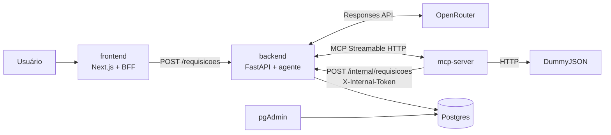

# Agente de compras

Chat em que o usuário descreve o que quer comprar em português. Um agente consulta o catálogo da [DummyJSON](https://dummyjson.com) por um servidor MCP e grava uma requisição de compra no Postgres, sempre com produtos e preços reais.

## Como rodar

1. `cp .env.example .env` e preencha `OPENROUTER_API_KEY` e `INTERNAL_API_TOKEN`. Gere o token com `python -c "import secrets; print(secrets.token_urlsafe(32))"`.
2. `docker compose up --build`
3. Abra http://localhost:3000 e envie: "Preciso de 3 laptops para o time de vendas, até US$ 2.000 cada."

| Serviço | Endereço |
|---|---|
| Chat (Next.js) | http://localhost:3000 |
| API (FastAPI) | http://localhost:8000/docs |
| pgAdmin | http://localhost:5050 (login no `.env`; o servidor `compras` já vem cadastrado) |

As tabelas são criadas sozinhas no start do backend, com `alembic upgrade head`. Se alguma porta estiver ocupada, pare o processo que a usa ou troque o lado esquerdo do `ports` no `compose.yml` do serviço.

## Arquitetura

A documentação completa (arquitetura, stack, cada serviço, API, dados e operação) está em [`docs/`](docs/README.md).



O fluxo:

1. O chat chama o próprio Route Handler do Next (BFF), que repassa o pedido ao backend.
2. O backend roda o agente. O modelo decide quais ferramentas chamar: `buscar_produtos`, `detalhar_produto` e `criar_requisicao`.
3. `criar_requisicao` só recebe ids e quantidades. O servidor MCP busca cada produto na DummyJSON e envia preço, estoque e pedido mínimo reais ao endpoint interno do backend.
4. O backend valida as regras e grava. A resposta traz a requisição, o que faltou e as ferramentas chamadas, que aparecem no chat.

O código segue DDD tático em dois contextos. **Catálogo** fica no `mcp-server` (produto, preço, DummyJSON). **Compras** fica no `backend` (requisição como agregado, regras de grounding, persistência). Cada serviço tem as camadas `domain`, `application`, `infrastructure` e `interfaces`. Os dados são modelos Pydantic em `schemas/`, separados por assunto e com uma classe por arquivo. Cada serviço tem seu `Dockerfile` e seu `compose.yml`; o `compose.yml` da raiz junta todos com `include`.

## Principais decisões

- **Loop de agente próprio, sem framework.** O modelo escolhe as tools via Responses API da OpenRouter. O loop explícito é fácil de explicar e de testar, ao custo de mais código próprio.
- **Só a tool grava.** A requisição nasce de `criar_requisicao`. Se o modelo disser que criou e nada foi gravado, a API responde 502 em vez de mostrar uma requisição falsa. Em troca, o pedido depende do modelo chamar a tool.
- **Grounding no servidor.** O modelo só informa id e quantidade. Título, preço, estoque e pedido mínimo vêm da DummyJSON, e o backend confere estoque, pedido mínimo e orçamento antes de gravar. Se uma regra falha, nada é gravado e o motivo volta ao modelo para ele corrigir. Isso custa uma ida a mais à DummyJSON por item.
- **Busca por categoria em vez de prompt em inglês.** O problema das buscas em português é o modelo não saber o que existe no catálogo, não o idioma do prompt. Por isso a `buscar_produtos` aceita uma `categoria` opcional, limitada às 24 categorias da DummyJSON. Sem nenhum produto da categoria com o termo, ela devolve a categoria inteira. O prompt continua em português, como a resposta ao usuário. A lista de categorias fica fixa no código e precisa ser atualizada se a DummyJSON mudar.
- **Defesa em profundidade contra ids inventados.** O backend recusa `criar_requisicao` com produtos que não apareceram nas buscas da conversa, sem nem chamar o MCP. O custo é que o modelo precisa buscar antes de criar.
- **Contexto injetado pelo sistema.** O texto do pedido e a chave de idempotência entram na chamada da tool pelo backend e ficam fora do schema que o modelo vê, então o modelo não pode adulterá-los. O schema da tool fica diferente do que o MCP publica.
- **Endpoint interno com token.** `POST /internal/requisicoes` exige `X-Internal-Token` (comparação em tempo constante) e não aparece no OpenAPI. O custo é mais um segredo no `.env`.
- **Dinheiro em `Decimal`.** A API usa `{"amount": "1999.99", "currency": "USD"}`, e o total é calculado no backend, nunca pelo modelo. Para o cliente, o valor é uma string.
- **Idempotência.** O header `Idempotency-Key` (ou uma chave gerada) é único no banco. Repetir o pedido devolve a mesma requisição com 200, sem rodar o agente de novo. A chave fica guardada para sempre.
- **Erros externos viram mensagens claras.** DummyJSON ou MCP fora retornam 503, timeout retorna 504, e uma chave ou modelo recusado na OpenRouter retorna 502. O MCP tenta de novo só em falhas transitórias. O pior caso de espera é cerca de 3 vezes o timeout.
- **Saída estruturada strict** (`json_schema`) com `openai/gpt-4.1-mini` e `require_parameters` na OpenRouter. Isso limita a escolha a providers que suportam tools e schema strict.
- **Testes e lint dentro do Docker** (estágio `test` de cada Dockerfile). Não é preciso instalar nada no host, e o CI roda os mesmos containers. Em troca, há rebuild da camada de código a cada execução.

## Testes

```bash
docker compose --profile test run --rm --build mcp-server-tests   # ruff + ty + pytest
docker compose --profile test run --rm --build backend-tests      # ruff + ty + pytest
```

Nenhum dos dois precisa de chave de LLM nem de internet. O MCP tem um arquivo de teste por tool, com o cliente MCP em memória e o catálogo falso. O CI (`.github/workflows/ci.yml`) roda esses dois containers, mais o lint e o build do frontend e o `docker compose config`.

### Evals (5 pedidos contra o sistema no ar)

```bash
docker compose --profile test run --rm -e EVALS_BASE_URL=http://backend:8000 backend-tests python -m evals.run_evals
```

Cada caso confere:

- o status HTTP;
- a categoria de cada item;
- a soma das quantidades;
- o orçamento;
- o total;
- que a requisição passou por `criar_requisicao`.

O título e o preço de cada item são conferidos direto na DummyJSON, sem passar pelo MCP.

Placar: **5/5 acertos** com `openai/gpt-4.1-mini` (11/11/2026).

## Uso de IA

Usei o Cursor (agente) como par de programação. Antes de codar, escrevi skills do projeto em `.cursor/skills/` com a arquitetura, as convenções (DDD, Pydantic, uma classe por arquivo, compose por serviço) e os padrões de cada peça. Com isso, o agente gerava código já no formato combinado.

Ficou comigo:

- as decisões de desenho, como "só a tool grava", grounding no servidor, token interno e formato do dinheiro;
- a revisão de cada mudança;
- os commits, um por arquivo e feitos por mim.

A IA escreveu a maior parte do código e dos testes e ajudou a depurar o ambiente. Os testes reais com a DummyJSON e a OpenRouter mostraram falhas que corrigimos: o modelo inventando um id, "notebook" sem resultado no catálogo e o provider recusando o schema.

## Limitações e próximos passos

- O catálogo é a DummyJSON, em dólar e em inglês, com cerca de 194 produtos em 24 categorias. O prompt traduz os termos e, quando a busca por palavra não acha, o modelo busca de novo pela `categoria` (um parâmetro opcional da `buscar_produtos`, que só aceita as categorias reais e mostra o que existe nelas). Ainda assim, um item que o catálogo não tem não aparece em nenhum idioma.
- Não há autenticação de usuário nem histórico por usuário. `GET /requisicoes` lista as mais recentes de todos.
- A resposta só chega no fim do loop do agente, sem streaming das etapas no chat.
- A chave de idempotência não expira.
- Próximos passos: streaming das tool calls, aprovação da requisição por um gestor e mais casos nos evals.
