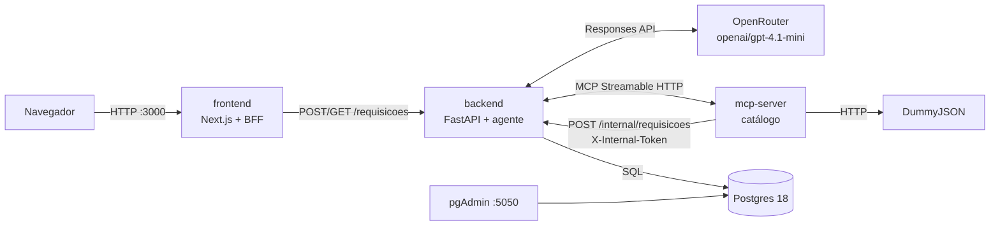
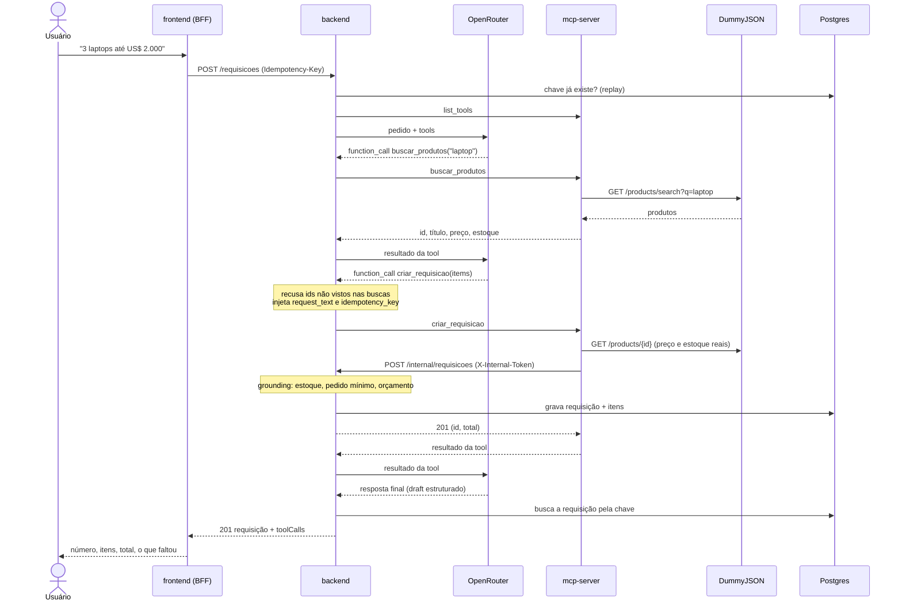

# Arquitetura

## Serviços

| Serviço | Papel | Porta no host |
|---|---|---|
| `frontend` | Chat e BFF (`/api/requisicoes`), que repassa ao backend sem expor a URL interna | 3000 |
| `backend` | API HTTP, loop do agente, grounding, persistência | 8000 |
| `mcp-server` | Expõe o catálogo como tools MCP e grava requisições via backend | só na rede interna |
| `db` | Postgres 18 com as tabelas `requisition` e `requisition_item` | só na rede interna |
| `pgadmin` | Interface para inspecionar o banco | 5050 |

Cada serviço tem seu `Dockerfile` e seu `compose.yml`. O `compose.yml` da raiz junta tudo com `include` e define o nome de projeto `agente-compras`. A ordem de subida é garantida por healthchecks: `db` e `mcp-server` saudáveis → `backend` → `frontend`.

## Contextos e camadas (DDD tático)

O domínio foi separado em dois contextos, um por serviço Python:

| Contexto | Serviço | Linguagem do contexto |
|---|---|---|
| **Catálogo** | `mcp-server` | Produto, preço, estoque, categoria, busca |
| **Compras** | `backend` | Requisição (agregado), item, orçamento, grounding, status |

Os dois serviços seguem as mesmas camadas:

| Camada | Responsabilidade | Depende de |
|---|---|---|
| `schemas/` | Modelos Pydantic por assunto, uma classe por arquivo | nada |
| `domain/` | Erros de domínio, ports (interfaces) e serviços de domínio | `schemas` |
| `application/` | Casos de uso que orquestram o domínio | `domain`, `schemas` |
| `infrastructure/` | Adapters: DummyJSON, OpenRouter, MCP, Postgres | todas as anteriores |
| `interfaces/` | Entrada: tools MCP, rotas HTTP, tradução de erros | `application` |
| `main.py` | Composition root: monta as dependências e sobe o servidor | tudo |

As dependências apontam para dentro: o domínio não conhece FastAPI, httpx nem SQLModel. Os testes trocam os adapters por fakes que implementam os mesmos ports.

## Fluxo de um pedido

Pontos importantes do fluxo:

1. **Só a tool grava.** O backend não monta a requisição a partir da resposta final do modelo. Depois do loop, ele procura no banco a requisição gravada com a chave do pedido. Se o modelo disse que criou e nada foi gravado, a API responde 502.
2. **O modelo só escolhe id e quantidade.** Título, preço, estoque e pedido mínimo vêm da DummyJSON pelo MCP no momento de gravar.
3. **Recusas voltam para o modelo.** Se uma regra falha (ex.: estoque insuficiente), nada é gravado e a mensagem volta como erro da tool; o modelo corrige a quantidade ou move o item para "o que faltou".
4. **Contexto injetado.** `request_text` e `idempotency_key` não aparecem no schema que o modelo vê; o backend os coloca na chamada, então o modelo não pode adulterá-los.

## Segurança

| Ameaça | Mitigação |
|---|---|
| Modelo inventa produto ou preço | Grounding no servidor: dados só da DummyJSON; ids não observados são recusados |
| Alguém grava requisições direto | `POST /internal/requisicoes` exige `X-Internal-Token` (comparação em tempo constante) e não aparece no OpenAPI |
| Modelo troca a chave de idempotência | Argumentos do sistema escondidos do schema e sobrescritos pelo backend |
| Segredos no repositório | `.env` e PDFs no `.gitignore`; `Settings` com `SecretStr`; compose com fail-fast `:?` |
| URL interna exposta ao navegador | O chat só conhece o BFF `/api/requisicoes`; `BACKEND_URL` fica no servidor do Next |
| DNS rebinding no MCP | Allowlist de hosts no transporte Streamable HTTP |
| Injeção no log via header | `X-Request-ID` só é aceito se casar com `^[A-Za-z0-9._-]{1,64}$` |
