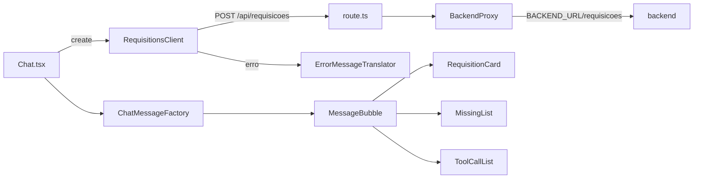

# Frontend (chat)

Pasta `frontend/`. Next.js 16 (App Router) com React 19, servido em http://localhost:3000.

## Como funciona

1. O usuário envia o pedido; `Chat` mostra a mensagem e o indicador "Consultando catálogo".
2. `RequisitionsClient` chama o BFF do próprio Next (`/api/requisicoes`) com uma `Idempotency-Key` nova por envio.
3. O Route Handler usa o `BackendProxy`, que repassa ao backend só `Content-Type`, `Idempotency-Key` e `X-Request-ID`, com timeout de `BACKEND_TIMEOUT_MS` (120 s).
4. A resposta vira uma mensagem do chat pela `ChatMessageFactory`: requisição criada, erro com o que faltou ou erro simples.

O navegador nunca conhece a URL interna do backend: `BACKEND_URL` só existe no servidor do Next.

## Organização

Componentes são funções; a lógica fica em classes, uma por arquivo.

| Arquivo | Tipo | Papel |
|---|---|---|
| `app/page.tsx`, `app/layout.tsx` | página | Layout e página do chat |
| `app/api/requisicoes/route.ts` | Route Handler | BFF: `POST` e `GET` repassados ao backend |
| `components/Chat.tsx` | componente | Histórico de mensagens e envio |
| `components/ChatInput.tsx` | componente | Campo de texto e botão de enviar |
| `components/MessageBubble.tsx` | componente | Uma mensagem (usuário ou agente) |
| `components/RequisitionCard.tsx` | componente | Número da requisição, itens, subtotais e total |
| `components/MissingList.tsx` | componente | O que não foi atendido e por quê |
| `components/ToolCallList.tsx` | componente | Ferramentas chamadas, argumentos, duração e erro |
| `lib/backend-proxy.ts` | classe | Proxy com timeout; rede fora → 502, timeout → 504, com `detail` |
| `lib/requisitions-client.ts` | classe | Chamada do navegador ao BFF |
| `lib/error-message-translator.ts` | classe | Garante mensagem legível para qualquer status, mesmo sem corpo JSON |
| `lib/money-formatter.ts` | classe | Formata `{amount, currency}` em moeda |
| `lib/chat-message-factory.ts` | classe | Converte respostas da API em mensagens do chat |
| `lib/types/` | tipos | Um tipo por arquivo, espelhando a API |

## Mensagens de erro

| Status | Mensagem padrão (quando a API não manda `detail`) |
|---|---|
| 422 | "Não foi possível montar a requisição com esse pedido." |
| 502 | "O agente de IA falhou ao processar o pedido. Tente novamente." |
| 503 | "O catálogo de produtos está indisponível no momento..." |
| 504 | "O agente demorou demais para responder. Tente novamente." |
| sem rede | "Sem conexão com o servidor do chat..." |

## Build

`next.config.ts` usa `output: "standalone"`; o Dockerfile tem três estágios (dependências, build, runner) e roda como usuário `node`.
