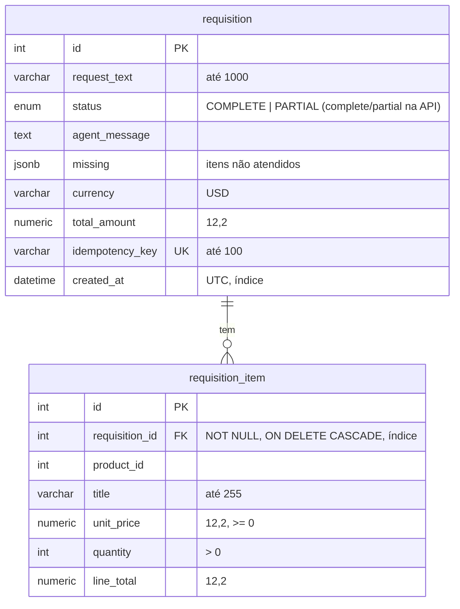

# Dados

Postgres 18, banco `compras` (configurável por `POSTGRES_DB`). Volume `db-data`.

## Tabelas



| Regra | Onde é garantida |
|---|---|
| Uma requisição por chave de idempotência | `UNIQUE (idempotency_key)`; corrida vira `DuplicateIdempotencyKeyError` e devolve a existente |
| Quantidade positiva | `CHECK quantity > 0` e `PositiveQuantityRule` |
| Preço não negativo | `CHECK unit_price >= 0` |
| Itens somem com a requisição | `ON DELETE CASCADE` |
| Dinheiro exato | `NUMERIC(12,2)` + `Decimal` no código |
| Preço do momento da compra | Título e preço ficam copiados no item (snapshot); mudanças futuras no catálogo não alteram requisições antigas |

## Mapeamento

O agregado `Requisition` (em `schemas/requisition/`) não conhece o banco. `RequisitionTableMapper` converte agregado ↔ tabelas; `SqlModelRequisitionRepository` carrega os itens com `selectinload` (sem N+1); `SqlModelUnitOfWork` controla a transação (requisição e itens gravados juntos).

## Migrations

- Alembic em `backend/app/infrastructure/persistence/migrations/`.
- `backend/scripts/prestart.sh` roda `alembic upgrade head` toda vez que o backend sobe: as tabelas são criadas automaticamente num banco vazio.
- As migrations usam só `DATABASE_URL` (`DatabaseSettings`), sem exigir a chave da OpenRouter.

## pgAdmin

http://localhost:5050, login com `PGADMIN_DEFAULT_EMAIL` / `PGADMIN_DEFAULT_PASSWORD` do `.env`. O servidor `compras` já vem cadastrado (`pgadmin/servers.json`); a senha do banco é pedida no primeiro acesso.

Consulta útil:

```sql
SELECT r.id, r.status, r.total_amount, i.title, i.quantity, i.unit_price
FROM requisition r JOIN requisition_item i ON i.requisition_id = r.id
ORDER BY r.created_at DESC;
```
